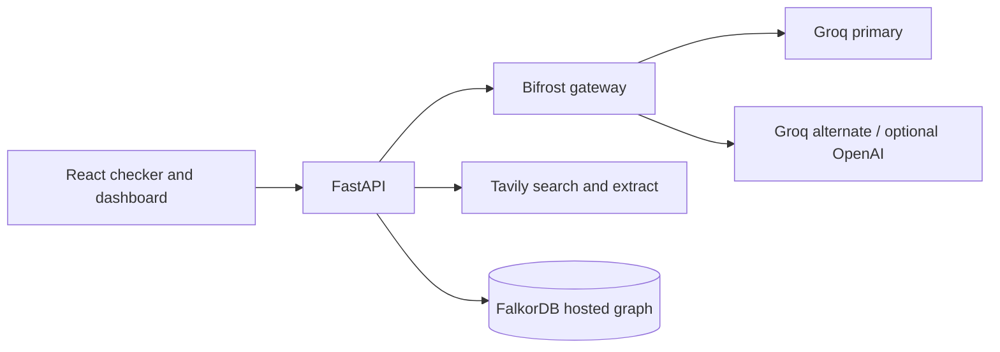

  

  
  
  
  
  
  
  

<strong>Catch facts that have gone stale.</strong> Check time-sensitive claims against live sources and trace how their values change over time.

FreshCheck checks generated answers against live web evidence and records claim history in **your hosted FalkorDB** instance. Groq model calls go through Bifrost.

## Architecture

## Run locally

1. Copy `.env.example` to `.env`.
2. Set `FALKORDB_URL` to the connection URL shown by FalkorDB Cloud (include TLS/password when supplied), plus `TAVILY_API_KEY` and `GROQ_API_KEY`.
3. Run `docker compose up --build`.
4. Open http://localhost:5173; API docs are at http://localhost:8000/docs.

The UI starts without keys, but live fact checking requires Tavily and Groq credentials. Bifrost's console is at http://localhost:8080. `GET /health` reports service availability and whether keys are configured.

### Preview the UI without installing packages

Open `http://localhost:5173/preview.html` after running `python -m http.server 5173 --directory frontend`. This standalone UI preview has sample-only interactions; its “Run preview” action does not verify facts or call the API. The production React app runs at `/` when Docker and npm dependencies are available.

## Configuration

| Variable | Purpose |
|---|---|
| `FALKORDB_URL` | Hosted Redis-compatible FalkorDB URL, including TLS scheme if required |
| `FALKORDB_USERNAME`, `FALKORDB_PASSWORD` | Cloud credentials if not embedded in URL |
| `FALKORDB_GRAPH` | Graph name (`freshcheck`) |
| `GROQ_API_KEY` | Primary provider key for Bifrost |
| `TAVILY_API_KEY` | Search and extraction |
| `BIFROST_URL`, `BIFROST_API_KEY` | Gateway endpoint and optional inference auth |
| `EXTRACTOR_MODEL`, `JUDGE_MODEL` | Configurable model routes |
| `BUDGET_USD_PER_RUN` | Per-answer cap |

The supplied task named `llama-3.1-8b-instant` and `llama-3.3-70b-versatile`. Groq's current deprecation page reports they were retired on Aug 16, 2026, so current defaults use `openai/gpt-oss-20b` and `openai/gpt-oss-120b`. Change the env values only to model IDs currently enabled in your Groq account.

Bifrost runs from `infra/bifrost/config.json`: it loads provider credentials from environment variables, routes through its OpenAI-compatible API, enforces a local virtual key, and sets a $5/day key budget. The app retries a secondary Groq model after failures; an optional OpenAI key enables a second provider fallback. Exact repeated answers are cached by FreshCheck. The Bifrost config uses its SQLite-backed admin store, so provider and gateway settings can also be reviewed in its admin UI.

## Temporal model

Each claim has a valid-time interval (when the value applies) and transaction time (`verified_at`, when FreshCheck learned it). Verification and evidence nodes are linked to claim versions. `GET /api/claims/history?entity=Groq&attribute=pricing&valid_at=2026-11-01&known_at=2026-11-04` filters what the process has recorded by the two times.

## Commands

`make up`, `make down`, `make test`, `make eval`, `make demo`, and `make lint` provide the standard workflows. Demo answer examples are in `demo/answers`. `make demo` inserts a sample prior value in the graph. Set credentials before running live checks.

## Known limitations

- Hosted FalkorDB needs a valid Cloud URL/credentials; the in-process fallback makes the UI usable but is not persistent.
- Live verdict quality depends on the available Groq model and source snippets. Quote validation requires exact quote copies.
- Cost and token metrics are currently conservative placeholders until Bifrost usage-log ingestion is configured.
- Bifrost provider governance, virtual-key budgets, and semantic caching are deployment settings; the supplied config seeds providers and request logging.
- `docker compose up` cannot validate external provider keys or hosted database reachability without your `.env` credentials.
